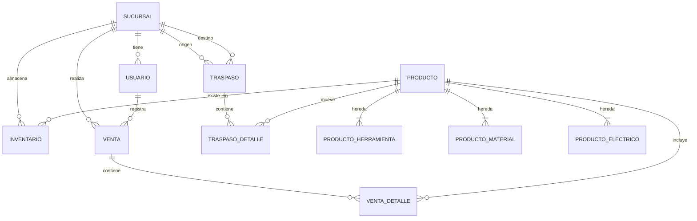

# Documento de estudio del proyecto (para explicar y defender)

> Sistema web de inventario y punto de venta multisucursal para ferreterías (Cancún, Playa del Carmen, Chetumal).
> Stack: PostgreSQL 18 (Docker) + Node.js/Express + React/Vite. Código y SQL comentados línea a línea en el repositorio.

## 1. Qué se construyó y dónde está
- **Repositorio:** `C:\Users\chant\ferreteria-pos`
- **Base de datos (Docker):** `docker-compose.yml` (servicio `db`, imagen `postgres:18`, contenedor `ferreteria_db`, host `localhost:5433`, BD/usuario `ferreteria`, volumen `pgdata`, scripts montados en `/docker-entrypoint-initdb.d`).
- **Scripts SQL:** `db/01_esquema.sql` (tablas núcleo, tipo compuesto, arreglos, JSONB), `db/02_herencia.sql` (INHERITS), `db/03_funciones.sql` (PL/pgSQL venta/traspaso), `db/04_triggers.sql` (bitácora), `db/05_vistas.sql`, `db/06_datos.sql` (semilla), `db/07_correcion_texto.sql` (UTF-8 en base ya cargada). Pruebas/notas: `db/pruebas/`.

- **Backend API:** `app/backend/src` (`index.js`, `db/pool.js`, `middleware/auth.js` y rutas en `routes/`: auth, productos, inventario, ventas, traspasos, reportes, codigosPostales, sucursales). Pruebas mínimas: `app/backend/tests/auth.test.js` con `npm test`.

- **Frontend:** `app/frontend/src` (`App.jsx`, `api.js`, `main.jsx`, `styles.css`, `diseno.css`, `colores.css`, `tipografia.css`, `vite.config.js`).

- **Documentación:** `docs/arquitectura.md`, `backlog.md`, `bitacora-ia.md`, `retrospectivas.md`, `manual_tecnico.md`, `manual_usuario.md`, `declaracion_ia.md`, `paso1_postgres_version.txt`.
- **Evidencias de producto reforzadas:** `docs/evidencias/producto_pw_normativa_dom.md`, `producto_pw_componentes_mvc.md`, `producto_bd_motor_conjuntos.md` y `guion_demo_vivo.md`.

## 2. Modelo de datos y BD orientada a objetos (U.I, U.II BD)
- **Relacional (U.I):** tablas `sucursal`, `usuario`, `producto`, `inventario`, `venta`, `venta_detalle`, `traspaso`, `traspaso_detalle`, `bitacora` con PK/FK/UNIQUE/CHECK. Evidencias: diagrama (ver sección 10) y DDL/DML en `db/01`-`07`.

- **Tipo compuesto:** `dimensiones_t (largo_cm, ancho_cm, alto_cm, peso_kg)` usado en `producto.dimensiones`.
- **Arreglos:** `etiquetas TEXT[]`, `codigos_alternos TEXT[]` en `producto` (búsqueda con `unnest`/GIN).
- **JSONB:** `especificaciones JSONB` en `producto` y `detalle JSONB` en `bitacora` (índice GIN en especificaciones).
- **Herencia (INHERITS):** `producto_herramienta`, `producto_material`, `producto_electrico` heredan de `producto` y agregan atributos propios. `SELECT * FROM producto` incluye hijas; `SELECT * FROM ONLY producto` solo la base. `tableoid::regclass` muestra la tabla real.
- **Nota importante (aprendida al cargar datos):** con herencia, las filas residen en tablas hijas y una FK desde otras tablas hacia `producto(id_producto)` padre no las valida; por eso `inventario/venta_detalle/traspaso_detalle` guardan `id_producto` sin FK directa y la integridad se controla por la lógica/funciones. El esquema corregido quedó en `db/01_esquema.sql`.

## 3. Lógica en BD: funciones, triggers, vistas (U.III BD)
- **Funciones PL/pgSQL (`db/03_funciones.sql`):**
  - `registrar_venta(folio, id_sucursal, id_usuario, items jsonb)`: inserta venta, recorre items, hace `SELECT stock ... FOR UPDATE` en `inventario`, valida existencia/stock, descuenta, inserta detalles, actualiza totales y registra bitácora. Todo en una transacción; si algo falla, se aborta (atomicidad).
  - `registrar_traspaso(...)`: valida origen≠destino, bloquea filas origen/destino, descuenta en origen y suma en destino (crea registro si no existe), inserta detalle y bitácora.
- **Triggers (`db/04_triggers.sql`):** `trg_inventario_bitacora` (AFTER INSERT/UPDATE en inventario) y `trg_venta_bitacora` (AFTER INSERT en venta) registran eventos en `bitacora` con JSONB.
- **Vistas (`db/05_vistas.sql`):** `v_existencias_sucursal` (producto/sucursal/cantidad), `v_existencias_consolidado` (stock total por producto), `v_ventas_por_sucursal` (conteo y total vendido).

## 4. Transacciones y concurrencia (U.IV BD)
- **Mecanismo:** las funciones ejecutan dentro de una transacción; `SELECT ... FOR UPDATE` bloquea la fila de inventario hasta COMMIT/ROLLBACK, serializando accesos concurrentes al mismo producto/sucursal.
- **Aislamiento:** PostgreSQL usa `READ COMMITTED` por defecto; el bloqueo de fila evita la sobreventa del “último artículo”. En escenarios más estrictos puede justificarse `SERIALIZABLE` con reintentos ante errores de serialización.
- **Prueba (ejecutada):** `db/pruebas/concurrencia_ultimo_articulo.sql` — dos sesiones venden 1 unidad con stock=1 (producto 6, sucursal 1): una confirma, la otra falla con “Stock insuficiente…”, stock final 0 y nunca negativo. Salidas reales en `docs/evidencias/resumen_evidencias.md` y captura `docs/evidencias/capturas/13-concurrencia-sesiones.png` (repetición `V-CONC-LIVE-A/B`).

## 5. Almacenamiento y consultas (U.III BD)
- **EXPLAIN ANALYZE e índices:** `db/pruebas/explain_analisis.sql` (planes de existencias/búsqueda, creación de índice `idx_producto_nombre`, comparación y vista agregada). Ejecutado; planes reales en `docs/evidencias/explain_resultados.txt`.
- **Estructura física:** tablespaces (`pg_default/pg_global`), páginas (~8KB), TOAST para columnas grandes (TEXT/JSONB/arreglos). Resultados reales en `docs/evidencias/almacenamiento_resultados.txt` y explicación en `db/pruebas/almacenamiento_notas.md`.

## 6. Recuperación PITR (U.IV BD) — ejecutada
- **Respaldo base:** `pg_basebackup -h 127.0.0.1 -U ferreteria -D /backup/base -Xs -P` → 31364 kB (100%).
- **WAL archivado:** `archive_mode = on`, `wal_level = replica`, `archive_command = 'cp %p /var/lib/postgresql/wal_archive/%f'`; 5 segmentos archivados, 0 fallos.
- **Escenario:** filas 1 y 2 antes del punto; punto de restauración `antes_fila3` (LSN `0/30076A8`, tiempo `01:42:06.042778+00`); fila 3 después (01:42:10.14).
- **Restauración:** `pitr_restore` con `recovery_target_time` y `recovery_target_action = 'promote'`; log `recovery stopping before commit of transaction 757, time 2026-11-17 01:42:07.570497+00`.
- **Resultado:** `pg_is_in_recovery = f` y solo filas 1 y 2 (la fila 3 no existe). Evidencia: `docs/evidencias/pitr_resultados.txt`.
- **Detalle clave:** `recovery.signal` se crea antes del primer arranque del contenedor restaurado; si se crea después, PostgreSQL ya avanzó el WAL y falla con `recovery ended before configured recovery target was reached`.

## 7. Base de datos distribuida (U.V BD) — ejecutada
- **Topología:** red `dist_net`; `dist_a` (5436, primario), `dist_b` (5437), `dist_replica` (5438, streaming). Configuración: `max_prepared_transactions=10` y `wal_level=replica` en A.
- **Particionamiento:** `venta_part` por `LIST (id_sucursal)` con 3 particiones; 4 filas repartidas 2/1/1. `EXPLAIN` con `id_sucursal = 2` solo lee `venta_part_playa` (poda de particiones).
- **Replicación:** `pg_stat_replication` en `streaming` (async); una fila insertada en el primario apareció en la réplica, que responde `pg_is_in_recovery = t` (solo lectura).
- **FDW:** `srv_b` + foreign table `inventario_b_remoto`; desde A se consultan las filas de `inventario_nodo_b` en B.
- **2PC:** `traspaso_2pc_a2` en A y `traspaso_2pc_b2` en B visibles en `pg_prepared_xacts`; `COMMIT PREPARED` en ambos y verificación de filas.
- **Limitación real documentada:** `postgres_fdw` no permite `PREPARE TRANSACTION` sobre tablas foráneas (`cannot PREPARE a transaction that has operated on postgres_fdw foreign tables`); el 2PC se demostró con dos transacciones preparadas explícitas.
- Evidencia: `docs/evidencias/distribuida_resultados.txt`; detalle y comandos en `db/pruebas/distribuida_notas.md`.

## 8. Aplicación web (Programación Web U.I-IV)
- **Arquitectura MVC/API (U.I, U.IV):** React (vista, puerto 5173, proxy `/api`) consume API REST Express (controladores/rutas, puerto 3001) que usa `pg` Pool hacia PostgreSQL. Flujo: evento DOM → fetch → ruta/controlador → SQL/PLpgSQL → JSON → actualización de vista.
- **Frontend dinámico (U.II):** búsqueda en vivo de productos (efecto con retardo, sin recargar), carrito de venta (estado React, agrega/incrementa, total calculado), manipulación/renderizado del DOM por componentes; HTML semántico base y estilos simples (reforzar WCAG en el documento).
- **Backend (U.III):** rutas Express, validación de entradas, middleware de sesión HMAC y roles, manejo centralizado de errores y consumo de **Banxico SIE** (`/api/banxico/tipo-cambio`, serie SF43718) con token `Bmx-Token`, timeout y respuestas controladas 400/502/503.
- **Frameworks (U.IV):** Express (routing, middlewares, JSON/CORS) y React+Vite (componentes, hooks, HMR/proxy). Redactar reportes de componentes e implementación MVC en el documento final.

## 9. API implementada (resumen)
- `GET /api/health` estado BD; `POST /api/auth/login` devuelve token HMAC; `GET /api/auth/me` reconcilia la sesión con la BD; `GET/POST/PUT /api/productos`; `GET /api/inventario?sucursal=`; `POST /api/ventas`; `POST /api/traspasos`; `GET /api/reportes/ventas-sucursal` y `/existencias-consolidado` (administrador/gerente); `GET /api/banxico/tipo-cambio`; `GET /api/sucursales`.

## 10. Diagrama relacional (Mermaid, base para tu diagrama formal)

> Ajusta y expórtalo como imagen/diagrama formal para el entregable.

## 11. Cómo explicarlo en la defensa (ideas clave)
- Recorre una petición completa: UI React (evento/búsqueda o confirmar venta) → `fetch /api/...` → ruta Express → función/SQL en PostgreSQL → respuesta JSON → re-render.
- Explica por qué `FOR UPDATE` evita sobreventa y cómo la transacción hace atómico el traspaso.
- Muestra herencia/tipo compuesto/arreglos/JSONB con consultas (`tableoid`, acceso a campos del compuesto, `unnest`, operadores JSONB).
- Lee un `EXPLAIN ANALYZE` (Seq Scan vs Index Scan, costo/filas reales) y justifica un índice.
- Describe PITR (basebackup+WAL) y 2PC (`PREPARE/COMMIT PREPARED`).

## 12. Estado real actual (ejecutado)

### Resultados de evidencias ejecutadas (2026-11-17)

Detalle completo con salidas reales en `docs/evidencias/resumen_evidencias.md`, `explain_resultados.txt`, `almacenamiento_resultados.txt`, `traspaso_resultados.txt`, `pitr_resultados.txt` y `distribuida_resultados.txt`.

- **Concurrencia (U.IV):** aislamiento `read committed`; Caja 1 confirmó `V-CONC-A` y Caja 2 quedó bloqueada (`wait_event_type = Lock`, `wait_event = transactionid`) y luego fue rechazada con `Stock insuficiente para producto 6: disponible 0, solicitado 1`. Stock final: sucursal 1 = 0, sucursal 3 = 5 (nunca negativo). De las dos ventas de la prueba, solo existe `V-CONC-A`.
- **EXPLAIN/índices (U.III):** la vista de existencias usa `Index Scan` + `Bitmap Index Scan` + `Hash Join`; la búsqueda `ILIKE '%cemento%'` usa `Append`/`Seq Scan` en las tablas hijas incluso tras crear `idx_producto_nombre` (comodín inicial y herencia). Justificación documentada y propuesta de mejora con `pg_trgm`+GIN en hijas.
- **Almacenamiento (U.III):** tras `ANALYZE`, `producto` (padre) tiene `relpages=0` (filas en hijas), hijas/inventario/venta/bitacora 1 página de 8192 bytes; TOAST en `producto` y `bitacora`; tablespaces `pg_default`/`pg_global`.
- **Traspaso (U.II/U.IV):** `T-DEMO-01` movió 2 unidades de cemento de Cancún a Playa: stock 20→18 y 12→14, traspaso `completado` y eventos en bitácora (atómico).
- **API externa (Web U.III):** `GET /api/banxico/tipo-cambio` respondió 200 con serie SF43718, fecha `25/11/2026` y valor `19.7040` MXN/USD; token inválido → 400 controlado. Salida en `docs/evidencias/api_externa_resultados.txt` y capturas 09/10.
- **PITR (U.IV):** clúster aparte `pitr_src`/`pitr_restore`; respaldo base de 31364 kB + 5 segmentos WAL archivados. Se recuperó al tiempo `2026-11-17 01:42:06.042778+00`: `pg_is_in_recovery = f` y solo filas 1 y 2; la fila 3 (posterior) no se recuperó. Evidencia en `docs/evidencias/pitr_resultados.txt`.
- **BD distribuida (U.V):** nodos `dist_a` (5436), `dist_b` (5437) y `dist_replica` (5438) en la red `dist_net`. Particionamiento LIST con poda (`EXPLAIN` solo lee `venta_part_playa`), replicación streaming verificada con `pg_stat_replication` y fila visible en la réplica (`pg_is_in_recovery = t`), FDW de A hacia B, y 2PC con `traspaso_2pc_a2`/`traspaso_2pc_b2` visibles en `pg_prepared_xacts` y confirmadas en ambos nodos. Limitación real: `postgres_fdw` no soporta `PREPARE TRANSACTION` sobre tablas foráneas. Evidencia en `docs/evidencias/distribuida_resultados.txt`.
- **Aprendizaje de ejecución:** el JSON del traspaso debe pasarse desde archivo SQL (`Get-Content -Raw ... | docker exec -i ... psql`) para evitar problemas de escape de comillas en PowerShell.

- BD en Docker saludable (PG 18.6). Scripts `01`-`06` aplicados; tras corregir FKs por herencia: **3 sucursales, 8 usuarios, 6 productos, 12 registros de inventario**, 4 ventas (`V-CONC-A`, 2 de la UI y `V-CONC-LIVE-A`), 1 traspaso (`T-DEMO-01`) y 28 eventos de bitácora. Producto 6 en sucursal 1 quedó en stock 0 tras la prueba de concurrencia.
- Backend/Frontend ejecutados (backend :3001, frontend :5173); `npm run build` pasó. Hay 13 capturas reales en `docs/evidencias/capturas/`, 18/18 issues cerrados y el PDF final en `docs/entrega_word/`.
